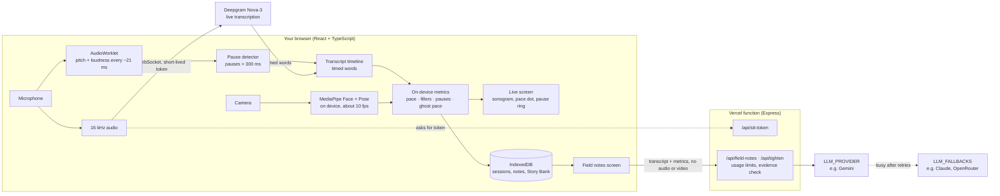

# Vireo

**A field guide to your voice: practise a talk, see your speech drawn like birdsong, and get one clear fix for the next take.**

<!-- DEMO GIF 1: docs/media/live-session.gif. See "Recording the demo" below for exactly what to record. -->
<!--  -->

<!-- DEMO GIF 2: docs/media/before-after.gif. See "Recording the demo" below. -->
<!--  -->

**[Try it → vireo-amber.vercel.app](https://vireo-amber.vercel.app)**: free, no sign-up. Use Chrome or Edge with a microphone; a camera is optional.

| Launch page | Home | Field notes |
| :---: | :---: | :---: |
|  |  |  |

> **Why "Vireo"?** The vireo is a North American songbird that sings the same clear phrase hundreds of times a day. That's the whole training plan.

## The practice loop

1. **Pick a situation.** Choose a card (job interview, a 60-second pitch, a toast and so on) and a starter question, or write your own or rehearse a story from your Story Bank. The warm-up checks your microphone and, if you want camera feedback, asks you to look at the camera for two seconds.
2. **Speak.** Your speech scrolls past as a sonogram ribbon. A pace dot drifts through your target zone and grows a ring when you rush, a ring fills while you hold a pause, and fillers leave small marks that fade. In *Coach me out loud* mode, a short spoken nudge comes only in your next pause; it never talks over you.
3. **Read your field notes.** They open with **one fix**, written as an instruction for the next take. Below it: your whole answer drawn with notes pinned to their moments, scores against your best, a story map, and **your answer, tightened** (your own words, with fillers cut and the main point moved first). Every quote is checked against your transcript.
4. **Take it again.** The retake keeps the one fix on screen, with an optional teleprompter, and a faint ghost dot replays your best take's pace so you race yourself.
5. **See what changed.** Before and after puts the two takes side by side. Share a card of the improvement (it never includes your transcript), save a PDF report, or add rehearsal reminders to your calendar.

## Situations

| Situation | Pace zone (words per minute) | What a good answer does |
| :--- | :---: | :--- |
| Job interview | 130–160 | Answers within the first 20 seconds, gives a situation, action and result, and ends on what was learned. Vireo asks a follow-up afterwards. |
| Presentation or class talk | 120–150 | Signposts the structure, slows down on the main idea, ends with a strong last line. |
| 60-second pitch | 140–170 | States the problem, the solution and a clear ask, inside a visible 60-second countdown. |
| Speaking English with confidence | 110–150 | Keeps a steady pace, uses few fillers, speaks in complete sentences. Tracked as a trend over weeks on Home. |
| Toast or big moment | 110–140 | Sounds warm, pauses before the laughs, ends with a clear closing line. |

Each situation has three starter questions. You can also write your own question (120–160 wpm) or rehearse from the **Story Bank**, where Vireo checks which of your story's key points you hit, even when you paraphrase.

## How it works



- **On your device:** pace, pauses, fillers, pitch and loudness come from the audio in the browser, and eye contact, posture, gestures and expression come from MediaPipe running in the browser.
- **Transcription:** Deepgram Nova-3 transcribes the audio with real word timings. The browser connects to it directly with a short-lived token from the server, so your Deepgram key never reaches the browser.
- **Field notes:** they come from the model you configure. Busy providers are retried (at about 1 s, 3 s and 7 s), then Vireo falls back to the next provider in `LLM_FALLBACKS`. The JSON is validated against a schema, and every quote, and every camera note's cited moment, is matched against what really happened before it reaches the screen. Notes that can't be backed up are dropped, and the page says so.

| Path | What's there |
| :--- | :--- |
| `src/components/sonogram/` | The sonogram renderer: pure geometry plus static, reveal and scrolling modes |
| `src/live/` | Live session engine, on-device metrics (`metrics/`) and the Deepgram client |
| `src/vision/` | On-device camera analysis with MediaPipe |
| `src/audio/pitch/` | Autocorrelation pitch estimate in an AudioWorklet |
| `src/pages/` | Launch, Home, Warm-up, Live, Field notes and Story Bank screens |
| `src/storage/` | IndexedDB storage, deletion, and the one-time import from the previous version |
| `server/` | HTTP API, Deepgram token grants, usage limits, and provider-agnostic field notes (`server/llm/`) |
| `api/index.js` | The Express API as one Vercel serverless function |
| `eval/` | Accuracy harness for the on-device metrics |
| `docs/design/` | Design system tokens and the screen designs this build follows |

## Privacy

Vireo measures as much as it can on your device, and is explicit about what it sends where.

**Stays on your device**

- **Video is never recorded, stored or uploaded.** The camera is analysed in the browser with MediaPipe; only timed events (like "looked away from 0:41 to 0:45") are kept, on this device.
- Pauses, pace, fillers, pitch and loudness are computed in the browser.
- Sessions (transcript, sonogram, metrics, field notes), your Story Bank and ghost pace are stored in this browser's IndexedDB. Nothing is kept on the server.

**Leaves your device**

| What | When | Goes to |
| :--- | :--- | :--- |
| Microphone audio (16 kHz), plus keyterms: distinctive words from your question and story, and your "Words Vireo should know" | During a live session | **Deepgram**, directly from your browser, for transcription. The server only issues the short-lived token that opens the connection. |
| Transcript text and timestamps, your prompt, situation, pace zone, on-device metrics, camera events (not images) and the chosen Story Bank outline | When field notes and the tightened answer are written | The Vireo server, which sends it to the provider in `LLM_PROVIDER` (and `LLM_FALLBACKS` if that one is busy): **Google Gemini**, **Anthropic** (Claude), or **OpenRouter** (which forwards it to the provider of the model you choose). |
| An anonymous random cookie and your IP address | When a session starts and when notes are written | The Vireo server, only to apply usage limits. Counters are kept in **Upstash Redis** when it's configured. |

The camera models are downloaded from Google's model storage and jsDelivr when a session starts; no frames are sent anywhere. The server stores no session data and writes no transcript text to its logs, only counts and errors. The share card and PDF report are drawn in your browser, and the share card never includes your transcript.

Each provider handles what it receives under its own terms. Check them for the account and tier you use: some free tiers let the provider use submitted content to improve its products.

**Deleting**

- **Delete session** on any field notes page removes its transcript, drawing, notes and ghost pace take.
- **Delete all data** on Home removes every session, note and story, plus the previous version's database, from this browser.

## Metric accuracy

`npm run eval` replays hand-labelled recordings through the same pause detector, transcript timeline and pace meter a live session uses, and reports filler precision and recall, words-per-minute mean absolute error, and pause F1. The label format and an Audacity labelling workflow are in [`eval/README.md`](eval/README.md).

<!-- Fill in from `npm run eval` once real recordings are labelled in eval/labels/. -->

| Metric | Result | Recordings | Total length |
| :--- | :---: | :---: | :---: |
| Filler precision | — | — | — |
| Filler recall | — | — | — |
| Pace error (WPM, mean absolute) | — | — | — |
| Pause F1 | — | — | — |

Results will appear here once real recordings are labelled. For now, only a synthetic example runs, as a check that the harness works.

## Local setup

You need Node.js 20 or newer, a [Deepgram API key](https://console.deepgram.com/signup) (Member role, so the server can issue short-lived tokens) for live transcription, and a key for at least one field notes provider.

```bash
git clone https://github.com/manoj2883/Vireo.git
cd Vireo
npm install
cp .env.example .env     # then add your keys
npm run start            # server on :3001, app on http://localhost:5173
```

On Windows, `start.ps1` or `start.bat` do the same. `.env` files are gitignored; only `.env.example` is committed.

### Choosing the field notes provider

Field notes can come from any of three providers, tried in the order `LLM_PROVIDER`, then `LLM_FALLBACKS`. Providers without a key are skipped.

| `LLM_PROVIDER` | Also set | Notes |
| :--- | :--- | :--- |
| `gemini` (default) | `GEMINI_API_KEY` | Optional `GEMINI_TEARDOWN_MODEL` (default `gemini-3.6-flash`). JSON is constrained to the field notes schema. |
| `anthropic` | `ANTHROPIC_API_KEY`, optional `ANTHROPIC_MODEL` (default `claude-opus-5-5`) | Structured outputs. Server-side refusal fallback is on by default; set `ANTHROPIC_FALLBACKS=off` to disable. Optional `ANTHROPIC_EFFORT`. |
| `openrouter` | `OPENROUTER_API_KEY`, `OPENROUTER_MODELS` | Comma-separated model IDs in fallback order. Free models rotate and get rate-limited, so list several. |

`GET /api/health` reports whether the live key and the field notes provider are configured.

### Coach voice

Spoken nudges are short pre-recorded clips in `public/coach/`, so they play instantly and no model is called during a session. To regenerate them with Deepgram text-to-speech:

```bash
npm run coach:clips        # uses DEEPGRAM_API_KEY; --voice aura-2-andromeda-en to change voice
```

Without the clips, the browser's own English voice says the same lines.

### Checks

```bash
npm run check     # type check, lint and tests (server, app and eval)
npm run eval      # accuracy of the on-device metrics against labelled recordings
```

The same type check, lint and tests run on every pull request in GitHub Actions.

## Deploy

Vireo deploys to [Vercel](https://vercel.com). The front end is served as static files, and `api/index.js` runs the Express API as one serverless function (`vercel.json` routes `/api/*` to it).

1. Import the GitHub repo in Vercel. The build command and output come from `package.json` and `vercel.json`.
2. In the project's **Environment Variables**, add the same keys as `.env.example`: at least `DEEPGRAM_API_KEY` and one field notes provider.
3. For usage limits shared across serverless instances, add the **Upstash** integration from the Vercel Marketplace (it sets `KV_REST_API_URL` and `KV_REST_API_TOKEN`) or set `UPSTASH_REDIS_REST_URL` and `UPSTASH_REDIS_REST_TOKEN`.
4. Deploy, then open `/api/health` on the live URL to check both keys are seen. If either is missing, the launch and warm-up pages say the demo is resting and won't start a session.

**Usage limits** (all optional, defaults in `.env.example`): sessions per visitor per hour and per day, sessions per IP per hour, field notes calls per visitor and per IP per hour, and `DAILY_SESSION_CAP`, a site-wide limit on transcription sessions per UTC day. Every live session also stops at 10 minutes. Without Upstash, counters are kept in memory, which is fine for one local server.

For a public launch, set `DAILY_SESSION_CAP=50` (the code default is 300) and raise it once you've seen real usage. Also set a spending limit (or at least a usage alert) in your Deepgram console, so a traffic spike can’t run up a bill unnoticed.

## Recording the demo

Two GIFs go at the top of this README. Record each at about 1280×720 in Chrome, keep it under 15 seconds and 8 MB, and turn it into a GIF with a tool like ScreenToGif (Windows) or Kap (Mac).

1. **`docs/media/live-session.gif`, a live session (about 10 seconds).** Pick *Job interview* → *Tell me about yourself*, with the camera on. Once the ribbon is scrolling: say "um" once, hold a full pause of about two seconds so the pause ring fills, then rush one sentence so the pace dot leaves the zone and grows its ring.
2. **`docs/media/before-after.gif`, the payoff (about 12 seconds).** Start on the field notes from that take with the one fix showing at the top, scroll briefly past the sonogram with its pinned notes, press **Try again with this fix**, do a short retake that follows the fix, then end on the before-and-after comparison.

Then remove the `<!--` and `-->` around each image line at the top.

## Licence

[MIT](LICENSE)
