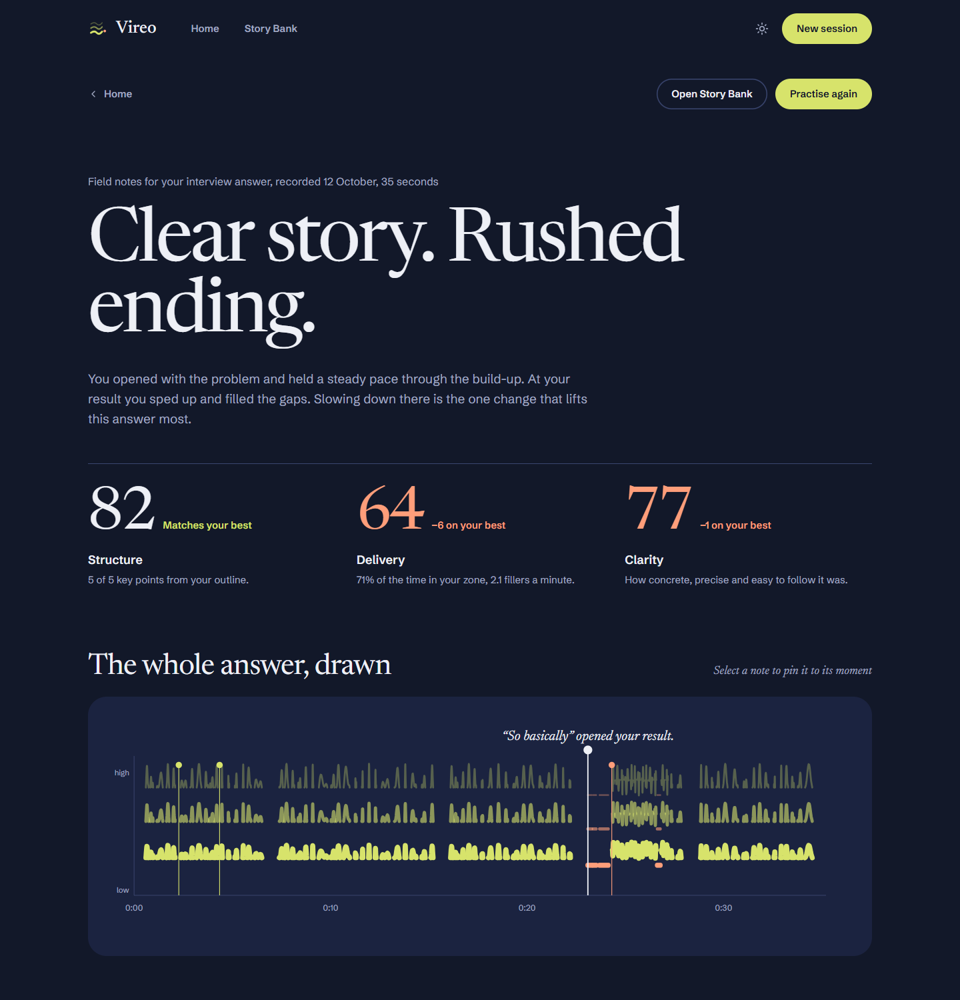
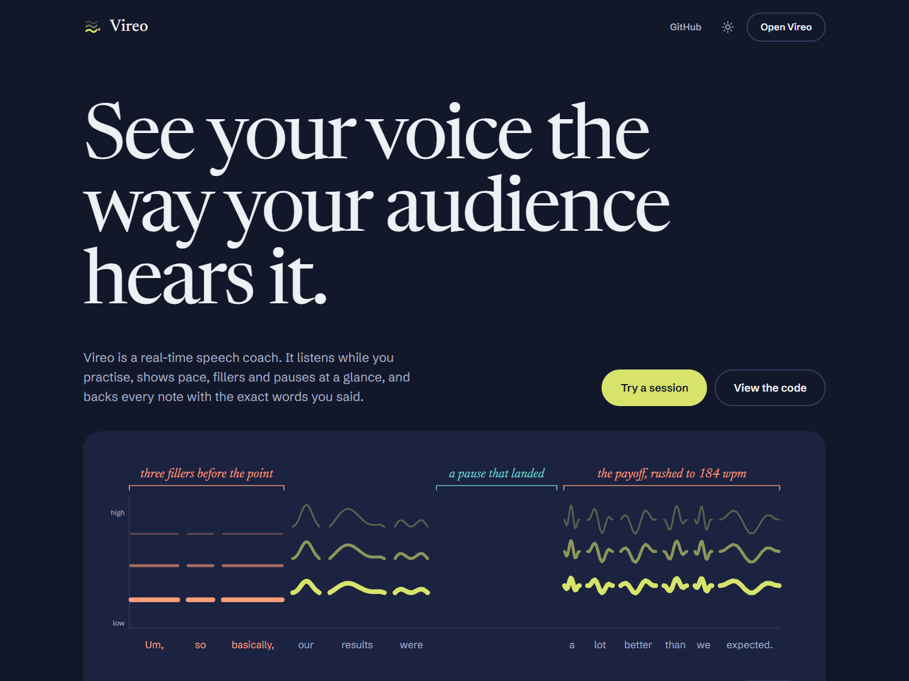
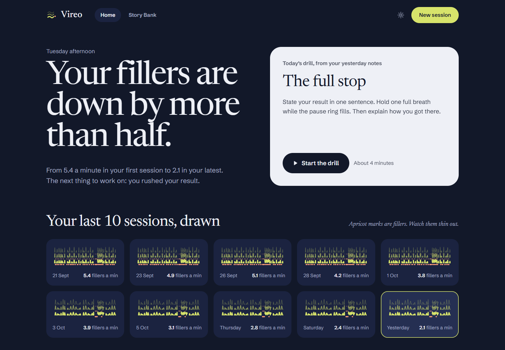
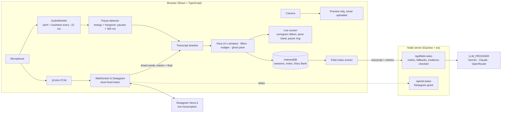

# Vireo

**A field guide to your voice.** Ornithologists draw birdsong as sonograms. Vireo draws your speech the same way while you practise, and pins field-guide notes to the moments that matter: a filler, a rushed result, a pause that landed. Every note quotes the exact words you said.



<!-- Live-session GIF goes here: docs/media/live-session.gif (see "Recording the demo" below). -->

| Launch page | Home |
| :---: | :---: |
|  |  |

> **Why "Vireo"?** The vireo is a North American songbird that sings the same clear phrase hundreds of times a day. That's the whole training plan.

## What it does

- **Live cues you can glance at.** A pace dot drifts through your target zone and grows a ring when you rush. A ring fills while you hold a pause. Fillers leave small triangle marks that fade. Your speech scrolls past as a sonogram ribbon.
- **Two coaching modes.** *Watch silently* shows visual cues only. *Coach me out loud* adds a short spoken nudge after your pace has been out of the zone for five seconds, and only in your next pause: it never talks over you, stops the moment you speak, and skips the nudge if no pause comes.
- **Field notes, backed by evidence.** After each session you get a verdict, structure, delivery and clarity scores compared with your best, the whole answer drawn with notes pinned to it, a story map, keep and fix notes beside the transcript, and drills. The server checks every quote against your transcript and drops any note it can't back up.
- **Audience mode.** Vireo asks the follow-up a sharp listener would ask, and *Answer it now* starts a short session on it.
- **Story Bank.** Keep the stories you tell often, with their key points. Rehearse one and Vireo checks which points you hit.
- **Ghost pace.** A faint dot replays your best take of the same prompt, so each rehearsal is a race against yourself.
- **Private by design.** Video is never stored, and sessions stay in your browser. See [Privacy](#privacy).

## How it works



Pace, pauses, fillers and pitch are measured on your device. Deepgram Nova-3 transcribes your audio with real word timings, straight from the browser using a short-lived token from the server. Spoken nudges use the browser's own voice. Field notes come from the model you configure. Their JSON is validated against a schema and retried once if invalid, and every quote is matched against the transcript before it reaches the screen.

| Path | What's there |
| :--- | :--- |
| `src/components/sonogram/` | The sonogram renderer: pure geometry plus static, reveal and scrolling modes |
| `src/live/` | Live session engine, on-device metrics (`metrics/`) and the Deepgram client |
| `src/audio/pitch/` | Autocorrelation pitch estimate in an AudioWorklet |
| `src/pages/` | Launch, Home, Warm-up, Live, Field notes and Story Bank screens |
| `src/storage/` | IndexedDB storage, deletion, and the one-time import from the previous version |
| `server/app.js`, `server/index.js`, `server/stt.js` | HTTP API and Deepgram token grants |
| `server/llm/` | Provider-agnostic field notes (`generateTeardown`), schema and evidence check |
| `eval/` | Accuracy harness for the on-device metrics |
| `docs/design/` | Design system tokens and the screen designs this build follows |

## Getting started

You need Node.js 20 or newer, a [Deepgram API key](https://console.deepgram.com/signup) (Member role) for live transcription, and a key for at least one field notes provider.

```bash
npm install
cd server && npm install && cd ..
cp .env.example .env     # then add your keys
npm run start            # server on :3001, app on http://localhost:5173
```

On Windows, `start.ps1` or `start.bat` do the same.

### Choosing the field notes provider

Live transcription uses Deepgram (`DEEPGRAM_API_KEY`). Field notes can come from any of three providers, tried in the order `LLM_PROVIDER`, then `LLM_FALLBACKS`, with retries for busy providers:

| `LLM_PROVIDER` | Also set | Notes |
| :--- | :--- | :--- |
| `gemini` (default) | `GEMINI_API_KEY` | Optional `GEMINI_TEARDOWN_MODEL` (default `gemini-3.6-flash`). JSON is constrained to the field notes schema. |
| `anthropic` | `ANTHROPIC_API_KEY`, optional `ANTHROPIC_MODEL` (default `claude-opus-5-5`) | Structured outputs. Server-side refusal fallback is on by default; set `ANTHROPIC_FALLBACKS=off` to disable. Optional `ANTHROPIC_EFFORT`. |
| `openrouter` | `OPENROUTER_API_KEY`, `OPENROUTER_MODELS` | Comma-separated model IDs in fallback order, sent as OpenRouter's `models` array. Free models rotate and get rate-limited, so list several. Nothing is hardcoded. |

`GET /api/health` reports whether the live key and the field notes provider are configured.

### Coach voice

Spoken nudges are short pre-recorded clips in `public/coach/`, so they play instantly and no model is called during a session. Generate them once with Deepgram text-to-speech:

```bash
npm run coach:clips        # uses DEEPGRAM_API_KEY; --voice aura-2-andromeda-en to change voice
```

Without the clips, the browser's own English voice says the same lines.

### Checks

```bash
npm run check     # type check, lint and tests (server, app and eval)
npm run eval      # accuracy of the on-device metrics against labelled recordings
```

## Accuracy

`npm run eval` replays hand-labelled recordings through the same voice detector, transcript timeline and pace meter a live session uses. It prints **filler precision and recall**, **WPM mean absolute error** and **pause F1** for each recording and overall. The label format and an Audacity labelling workflow are in [`eval/README.md`](eval/README.md). A synthetic example runs out of the box. It's a sanity check, not a benchmark: real numbers need real recordings.

## Privacy

Vireo measures as much as it can on your device, and is explicit about what it sends where.

**Stays on your device**

- **Video is never recorded or stored**, by the browser or the server.
- Pauses, pace, fillers, pitch and loudness are computed in the browser.
- Sessions (transcript, sonogram, metrics, field notes), your Story Bank and ghost pace are stored in this browser's IndexedDB. Nothing is kept on the server.

**Leaves your device**

| What | When | Goes to |
| :--- | :--- | :--- |
| Microphone audio (16 kHz) | During a live session | **Deepgram**, directly from your browser, for transcription. Your server only issues the short-lived token that opens the connection. |
| Transcript text and timestamps, your prompt, talk type, pace zone, on-device metrics, and the chosen Story Bank outline | When field notes are written | Your Vireo server, which sends it to the provider in `LLM_PROVIDER`: **Google Gemini**, **Anthropic** (Claude), or **OpenRouter** (which forwards it to the provider of the model you choose). |

The camera is used only for the preview on your screen. The server stores nothing and writes no transcript text to its logs, only counts and errors.

Each provider handles what it receives under its own terms. Check them for the account and tier you use: some free tiers let the provider use submitted content to improve its products.

**Deleting**

- **Delete session** on any field notes page removes its transcript, drawing, notes and ghost pace take.
- **Delete all data** on Home removes every session, note and story, plus the previous version's database, from this browser.

## Deploying

The `Dockerfile` builds the front end and serves it from the Node server on one port. `render.yaml` is a [Render](https://render.com) blueprint for that image: create a Blueprint from this repo, then add your keys as environment variables in the dashboard. Any host that runs a Docker container with WebSocket support works the same way.

## Recording the demo

The GIF at the top should show a real live session. Run the app with a Gemini key, start a session in a browser, and screen-record about ten seconds, ideally while saying a filler, holding a pause and rushing a sentence. Save it as `docs/media/live-session.gif`.

## License

MIT. Made by Manoj Kumar Gangineni.
